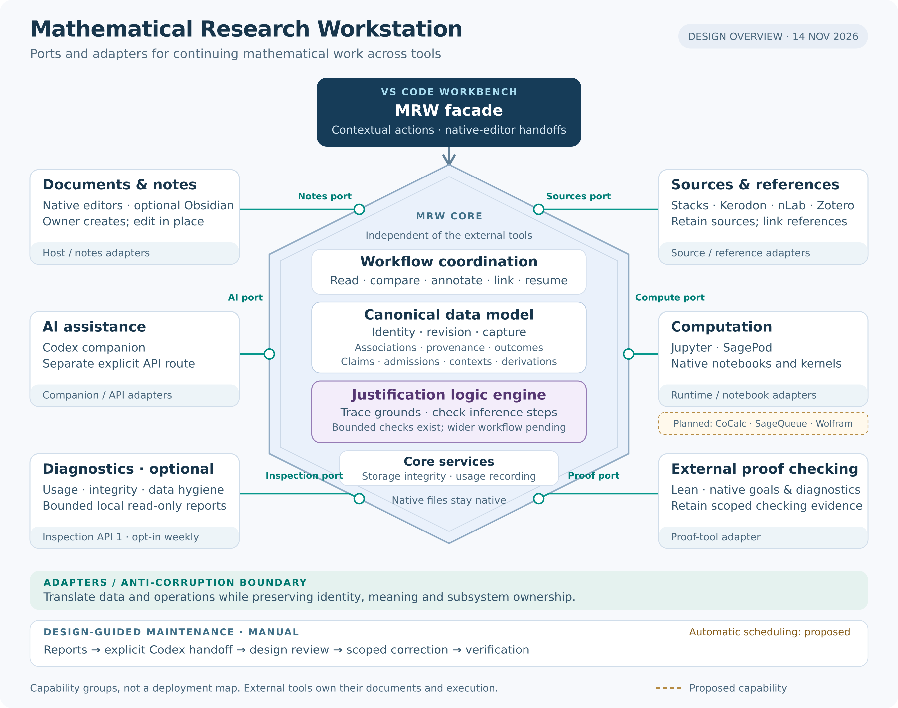

# Mathematical Research Workstation

MRW brings mathematical reading, source notes, calculations and proof work into
a VS Code workspace. Read a paper or note, follow its references, record an
observation and return to the argument. MRW retains exact source passages and
results; companion applications keep their editing and execution workflows.

The [field-trace example](docs/examples/field-trace/trace.md) starts with a
counterexample to a coefficient formula and proves the missing degree factor.
[Work through an argument](docs/MATHEMATICS_WITH_NOTES.md) shows how ordinary
linked notes, Return and saved calculations support that work.

**MRW 0.23.44 — Grounds from existing notes.**
[Download MRW](https://github.com/flengyel/MRW/releases/download/v0.23.44/mrw-0.23.44.vsix)
· [Release and checksums](https://github.com/flengyel/MRW/releases/tag/v0.23.44)
· [Installation](docs/INSTALLATION.md) · [Guides](docs/README.md).
The extension ID is `flengyel.mrw`. Distribution is through GitHub VSIX files;
there is no Marketplace listing. MRW remains experimental.

## Open a document

Start with [MRW workspace setup](docs/WORKSPACE_SETUP.md). The default is
`~/mrw-work/MRW.code-workspace` on the Linux host. Your notes folder can remain
elsewhere, including in a Windows Obsidian vault accessed from WSL.

1. Choose **Open Document… → Original file**. Markdown opens in preview;
   PDFs and other files use a registered reader or editor.
2. Choose **Show Contents** for a Markdown document. Contents lists its headings
   and links, including unsaved edits. The Commands view remains available.
3. Follow a link through Contents or **Follow Document Link**, or click a
   WikiLink in preview. **Return to Document** returns to the originating
   occurrence. Missing or ambiguous targets are reported.
4. Choose **Recent Documents…** to reopen notes, PDFs and other files after a
   restart. **Reopen Document** restores a Markdown selection when it still
   matches. PDF pages and preview scroll positions are not restored.

The document picker shows filenames immediately and adds YAML or heading titles
as they are read. Browse subfolders or choose **Search subfolders…**; incomplete
searches are identified. Browsing leaves the configured notes folder unchanged.
**Saved copy** and **Open Saved Source…** open a retained source revision and its
annotations. They do not replace the original file or refresh that revision.

### Notes while reading

Choose **Choose Notes Folder…** for note-ID lookup and backlinks. It remembers
recent folders with their full paths. The folder need not be an Obsidian vault.

**New Note…** delegates creation to the configured authoring application. For
Obsidian, it runs your selected creation command and template in Obsidian. For
an ordinary notes folder, it opens a blank Markdown editor. Your current
document stays open. See [note companions](docs/NOTE_COMPANIONS.md).

Reader notes belong beside their retained passages. Add or edit the text,
delete a note, link an Obsidian note, or continue it through the configured
note-creation handoff. MRW source notes and Zettelkasten notes can develop
independently. [Reader notes](docs/READER_NOTE_WRITING.md) ·
[Obsidian handoff](docs/OBSIDIAN_WORKFLOW.md).

## What works

| Task | MRW route |
| --- | --- |
| Read linked notes | Markdown preview, Contents, ordinary links, WikiLinks, backlinks and Return. |
| Keep a source passage | Import a Stacks Project, Kerodon or supported nLab page; retain its revision, exact text and reader annotations. |
| Read a PDF | Open it in a registered viewer and keep the referring document available. A separate source note needs no OCR. |
| Write mathematics | Render notation and supported note-local macros; compile fenced TikZ diagrams explicitly. |
| Work with a proof | Open Lean source with the official Lean extension, or inspect a Proof Outline and its cited passages. |
| Compare grounds | Search under displayed admissions, retain checked routes, inspect their sources and open a successor or predecessor context. |
| Retain a calculation | Capture a saved notebook, reopen its outputs, compare alternatives and export provenance. |
| Consult AI | Copy selected material to Codex, or use the separate API request preview and explicit Send action. |

## Justification Logic

**Justification Logic** studies assertions together with explicit reasons for
them. MRW follows the framework presented by Sergei Artemov and Melvin Fitting
in *[Justification Logic: Reasoning with Reasons](https://doi.org/10.1017/9781108348034)*,
Cambridge Tracts in Mathematics **216**, Cambridge University Press, **2019**.

The expression `t:A` says that `t` is a reason for the assertion `A`.
Application composes reasons: from `s:(A → B)` and `t:A`, it derives
`s·t:B`. This gives an argument an inspectable dependency on its reasons.
In MRW, those reasons can refer to exact source passages, retained calculation
results or formal proof artifacts. Provenance identifies where an artifact
came from; the logic checks the stated inference from admitted reasons.

A **ground** is a source, result or argument offered in support of a claim.
An **admission** records the assertion accepted for a particular argument,
its scope and who admitted it. A **context** selects the admissions available
to a derivation. Selecting or saving a passage does not admit its assertions.

MRW implements non-factive J₀/J(CS) profiles: it does not infer bare `A` from
`t:A`. The checker supports Application, Sum and its specified propositional
rules. Sum represents alternative reasons, not accumulated confidence.
The reader currently uses J₀ and searches bounded Application routes from
explicit admissions.

Select Markdown text and choose **Justification… → Use selected Markdown text**,
or choose saved passages. Copy their exact text and schema to Codex, import its
proposal and correct claim summaries in the reader. Select the grounds to admit;
Lean search remains a separate action. Sources, supplied attribution and corrections
are retained. See the [workflow](docs/SOURCE_GROUNDS_WORKFLOW.md).

Choose **Proofs → Justification… → Explore Euclid’s lemma**. Its two arguments
use Bézout’s identity and unique prime factorization. Read their source text
and admissions, then choose **Search under these admissions**. Each retained
route identifies the grounds it uses. Source buttons show the exact captured
passage; **Back to routes** restores the comparison.

**Withdraw a ground…** checks a successor context. The earlier context,
certificates and sources remain saved. Reopen either context through
**Justification…** after a restart; reopening performs no new Lean run.
Unfinished searches reopen from the same picker with their exact saved context
and Return location; retry remains explicit.

The checked routes are conditional on the displayed admissions. The Euclid
example does not independently formalize its arithmetic arguments, and a
checked formal statement does not establish its correspondence with a paper.
General proof search remains open work. The
[walkthrough](docs/JUSTIFICATION_EUCLID_EXAMPLE.md) gives both mathematical
arguments; the [guide](docs/JUSTIFICATION_WORKFLOW.md) describes the supported
interaction and limits.

Checking requires an explicit build of MRW’s packaged runtime with an already
installed Lean 4.32.2 toolchain. Setup downloads nothing. The current executable
identity is verified on Linux x86-64/WSL; another compiler output is rejected.
Saved results and ordinary reading remain available without that runtime.

## Zotero references

Use **Sources and References → Find Zotero Reference…** to find a reference,
insert a citation or follow an attachment. In Zotero, enable **Settings →
Advanced → Allow other applications on this computer to communicate with
Zotero** and keep it running for new lookups.

Pandoc-style citations such as `[@key]` render through the selected citation
processor and a bibliography or Better BibTeX lookup. Snapshot notices identify
the library or bibliography actually read. Windows Zotero can be reached from
WSL through Windows loopback, without forwarding its API port.
[Setup and limits](docs/ZOTERO_WORKFLOW.md).

### Notebook results

Use Jupyter with a SagePod SageMath kernel or another configured kernel. Retain
a saved notebook and optional companion notes, reopen its outputs, compare
alternatives and export their provenance. A retained output and a reported
execution are distinct records; reopening restores neither a kernel nor a
running calculation. SageQueue queues SageMath jobs through SagePod; an MRW
SageQueue adapter is not implemented. [Notebook workflow](docs/NOTEBOOK_RESULTS.md).

## Other reading tools

- [Lean study](docs/LEAN_STUDY_WORKFLOW.md) provides introductory companion
  lessons, editable core-only examples, solutions and notes. The lesson project
  pins Lean 4.33.0; the justification runtime separately pins 4.32.2.
- [Stacks Project and Kerodon](docs/STACKS_WORKFLOW.md) use qualified identifiers
  such as `stacks-project:08ZE` and `kerodon:0004`. A stable identifier names a
  source; retained citations also preserve its revision and exact passage.
- [Source plugins](docs/SOURCE_PLUGINS.md) support registered readers, including
  [nLab](docs/NLAB_WORKFLOW.md). Retained text remains readable without its plugin.
- [TikZ](docs/TIKZ_WORKFLOW.md) rendering preserves the note or annotation source
  and compiles only on request, using separately installed tools.
- [Proof Outlines](docs/PROOF_GRAPH_WORKFLOW.md) show claims and citations, allow
  summary corrections and simplify the display. Graph validation is distinct
  from checking the mathematical argument.
- [AI assistance](docs/READER_AI_WORKFLOW.md) separates companion clipboard
  handoffs from API requests, exact previews and Send.

The maintainer’s optional Zettelkasten conventions are documented independently
in [flengyel/Zettel](https://github.com/flengyel/Zettel) and its
[wiki](https://github.com/flengyel/Zettel/wiki). MRW imposes no Zettel format.

## Host and installation

MRW and Python run on a Linux workspace host, including WSL2 or Remote SSH;
Windows VS Code may provide the interface. Ordinary reading requires VS Code
1.95+ and Python 3.11+. It needs no Qt, Lean, SageMath or AI account.

Windows VS Code with Debian WSL is the current checked arrangement. Earlier
reader checks also cover Debian ARM64 over SSH; that does not qualify the
separate x86-64 justification runtime. Native Windows/macOS backends and
Windows-backed private artifact storage are unqualified.

In the intended Linux/WSL/SSH window, run **Extensions: Install from VSIX…** for
`mrw-0.23.44.vsix`. The recommended companion is
[MRW Diagnostics 0.1.0](https://github.com/flengyel/MRW/releases/download/v0.23.44/mrw-diagnostics-0.1.0.vsix);
it is optional, and weekly reporting is opt-in. Save work before a requested
reload and retain workspace storage when upgrading. GitHub updates require
installing the newer VSIX. [Installation guide](docs/INSTALLATION.md).

## Recommended extensions

Install companions for the tasks you use, on the appropriate workspace host:

| Task | Companion |
| --- | --- |
| LaTeX editing and PDF viewing | `James-Yu.latex-workshop`, plus a TeX distribution. |
| Lean editing and live goals | `leanprover.lean4`, plus Lean/elan. |
| Notebook work | `ms-toolsai.jupyter`, connected to a separate kernel such as SagePod. |
| SageMath language support | `Lov3.sagemath-enhanced`. |
| Additional Markdown preview/export | `shd101wyy.markdown-preview-enhanced`. |
| PDF viewing without another suitable reader | `tomoki1207.pdf`; its cross-host MRW handoff remains unobserved. |

The [companion guide](docs/RECOMMENDED_EXTENSIONS.md) explains placement,
prerequisites and compatibility. Keep a previewer or PDF reader that works.

## Data and transfers

Notes, Lean files, notebooks and proof graphs remain ordinary files. Their
editors own saving, undo and buffer recovery. MRW stores source captures,
annotations, API investigation records and immutable justification results
separately from those files. Copying a Markdown link does not copy its private
target. [Storage and moves](docs/ARTIFACT_STORAGE.md).

**Move Saved Work Directory…** transfers the supported source, annotation,
API investigation and justification records. It does not transfer every
notebook result, study checkpoint or history record. **Move Workspace…** has
its own verified workspace scope and recovery. Keep exports and backups.

Core history records MRW operations, not unrelated application activity.
Diagnostics provides bounded local usage/integrity reports and an explicit
Codex handoff. Shared history and weekly reporting are optional; missing
observations are not zero use. [Diagnostics](diagnostics/README.md) ·
[Shared history](docs/USAGE_HISTORY.md).

## Optional source study

Saved studies, attempts, proof-work questions and opt-in spaced review remain
separately accessible through the Command Palette. **Resume Study**, history
inspection/export and Archive/Restore or Trash controls preserve earlier work.
They are not part of opening a note or following a link.
[Study workflow](docs/ACTIVE_STUDY_WORKFLOW.md) ·
[Lifecycle and recovery](docs/STUDY_LIFECYCLE.md).

## Architecture

MRW coordinates references and retained evidence while each companion owns its
editor, kernel or execution service. Its core includes the Justification Logic engine,
source stores and recording/recovery services. Capability-specific adapters
connect documents, calculations, proof tools and AI.

[Architecture](docs/ARCHITECTURE.md) · [Scalable diagram](docs/assets/mrw-architecture.svg) ·
[Design and current status](docs/DESIGN_RECONCILIATION.md).
The proposed [CoCalc adapter](docs/COCALC_ADAPTER.md), general context assembly
and broader inference search remain unimplemented.

## Limits and contributions

MRW does not extract PDF text, restore PDF pages or preview scroll positions,
render every Obsidian embed or interpret arbitrary LaTeX preambles. General
proof checking, automatic prerequisite discovery and live calculation-session
recovery are not delivered. Concurrent hosts writing one private store are
unsupported. Feature-specific limits and observations are recorded in the guides.

Contributions should address a concrete obstacle in mathematical work while
preserving source attribution, notes and unfinished work.
[Contributing](CONTRIBUTING.md) · [Release procedure](docs/RELEASING.md).

## Project documents and license

[Documentation](docs/README.md) · [Research design](docs/RESEARCH_WORKSTATION_DESIGN.md) ·
[Provenance](docs/PROVENANCE_DESIGN.md) · [Domain model](DOMAIN_MODEL.md) ·
[Vocabulary](VOCABULARY.md) · [UX specification](UX_SPEC.md) · [Changelog](CHANGELOG.md).
[AGENTS.md](AGENTS.md), [CODEX_PLAN.md](CODEX_PLAN.md) and the
[continuation](docs/CODEX_CONTINUATION.md) guide development.
[Earlier extension details](docs/VS_CODE_DEVELOPMENT_HISTORY.md) include the
separate Qt/CLI prototype.

Copyright 2026 F. Lengyel. MRW code is [Apache-2.0](LICENSE); bundled dependencies
retain their notices. Stacks fixtures retain [upstream attribution and
GFDL terms](tests/fixtures/stacks/README.md). The project license does not
relicense source material. See [publication notes](PUBLIC_READINESS.md).
