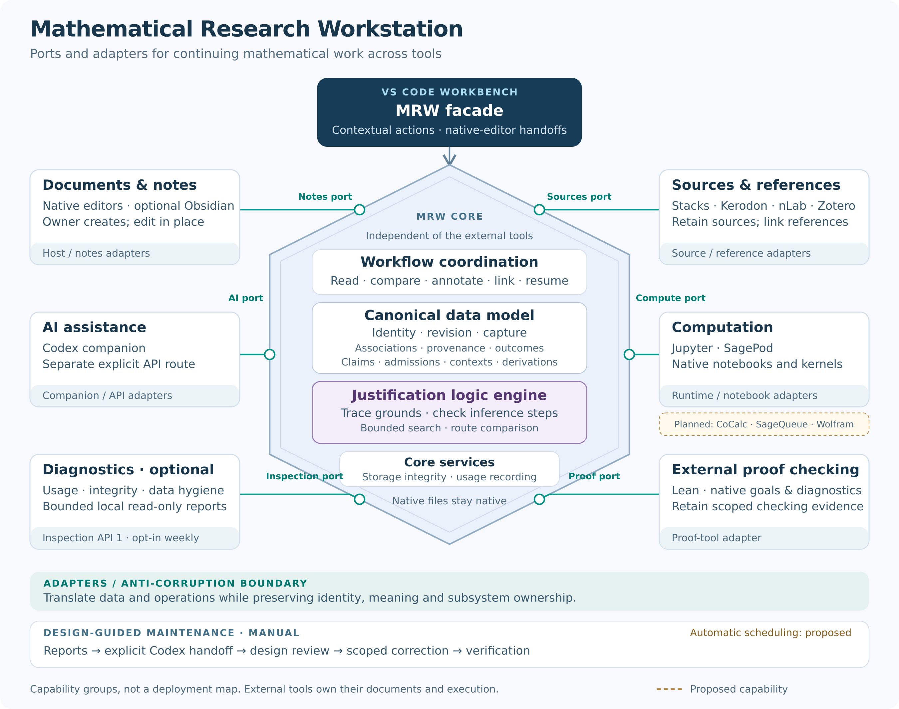

# Architecture in brief

The VS Code extension connects a passage in a paper or note to the sources,
calculations and proof steps that bear on it. MRW keeps the references needed
to return to that work. Native editors, kernels and proof checkers manage
their own files and execution.

The hexagon groups responsibilities. Dashed elements are proposed.
[Scalable diagram](assets/mrw-architecture.svg) · [Implementation status](DESIGN_RECONCILIATION.md)

| Component | Responsibility |
| --- | --- |
| Facade | Presents MRW actions in the context of the current document or selection. |
| Ports and adapters | A port specifies an operation the core needs. An adapter implements it for a particular editor, source or service. |
| Anti-corruption layer | Translates external records while preserving their identity, revision and attribution. A citation returned by a reference manager, for example, identifies a work. It supplies no premise until the reader admits one. |
| Workflow coordination | Connects actions across tools and records which requests were dispatched, accepted or completed. Returning to a saved calculation opens its result without executing the notebook. |
| Canonical data model | Distinguishes a work, its location, a retained revision and a passage in that revision. Claims, admissions, derivations and their links to sources have separate records. [Data model](../DOMAIN_MODEL.md) |
| Justification logic engine | Checks derivations under selected admissions. Bounded search finds alternative routes and records which admissions each route uses. [Search and withdrawal](JUSTIFICATION_ROUTE_SEARCH.md) |
| Core services | Store retained records, check their integrity and record local feature use. [Storage](ARTIFACT_STORAGE.md) · [Operational usage](OPERATIONAL_USAGE.md) |

In [source study](ACTIVE_STUDY_WORKFLOW.md), a question refers to a particular
passage. MRW keeps the submitted attempt, retained feedback and subsequent
corrections. The reader can reopen the attempt or keep the question for spaced
review.

The engine implements a non-factive fragment of Sergei Artemov’s Justification
Logic. A derivation of $t:A$ under stated admissions establishes that $t$ is a
reason for $A$ in that context. It does not establish $A$ itself. The two proofs
of Euclid’s lemma illustrate why dependencies matter. Withdrawing the admitted
implication from Bézout’s identity to Euclid’s lemma leaves the route through unique prime factorization available.
[Artemov and Fitting, chapters 2–3](https://doi.org/10.1017/9781108348034) ·
[Euclid’s lemma](JUSTIFICATION_EUCLID_EXAMPLE.md) · [Checker specification](JUSTIFICATION_LOGIC_EXPERIMENT.md)

Jupyter and SagePod run notebooks, the Lean extension checks proofs, and Zotero
manages references. The optional diagnostics extension uses the inspection
interface to produce local reports. A CoCalc adapter for remote projects and
notebooks is proposed. [Integration boundaries](INTEGRATION_BOUNDARIES.md) ·
[Diagnostics](DIAGNOSTICS_PLUGIN.md) · [CoCalc proposal](COCALC_ADAPTER.md)

The separate Lean library `MRW.Contracts` models relocation and the preservation
of exact citations. Its proofs concern the model. Tests compare selected
JavaScript operations with the model’s predictions.
[Relocation model and checks](CONTRACT_PILOT.md)
